<h1></h1>

A personal collection of reusable agent skills, installable with [`skillsfile`](https://github.com/richard-better/skillsfile) or [`skills`](https://github.com/vercel-labs/skills).

The skills are built and tested in [T3 Code](https://github.com/pingdotgg/t3code). Its
`delegate_task` runs subagents on models from different providers, and its thread tools let one
conversation manage others. Some skills need those tools; the rest work in any agent and run
best in T3 Code.

## Skills

<table>
<tr>
<td width="34%" valign="top" rowspan="5">
<code>01</code>
<h3>For work</h3>
Ask several models at once, and let agents grind toward a goal you can measure.
</td>
<td width="33%" valign="top">
<a href="./skills/council/"></a>
<br><a href="./skills/council/"><strong><code>council</code></strong></a><br>
Ask models from three labs the same question and see where they agree, adapted from <a href="https://github.com/t3dotgg/tstack/tree/main/skills/council">tstack</a><br>Say <em>"council"</em>
</td>
<td width="33%" valign="top">
<a href="./skills/council-debate/"></a>
<br><a href="./skills/council-debate/"><strong><code>council-debate</code></strong></a><br>
Debate rounds for <code>council</code>: each member rebuts the others<br>Say <em>"council, debate this"</em>
</td>
</tr>
<tr></tr>
<tr>
<td width="33%" valign="top">
<a href="./skills/outer-loop-t3/"></a>
<br><a href="./skills/outer-loop-t3/"><strong><code>outer-loop-t3</code></strong></a><br>
One thread that launches, unblocks and supervises your other threads<br>Say <em>"outer loop"</em>
</td>
<td width="33%" valign="top">
<a href="./skills/hill-climb/"></a>
<br><a href="./skills/hill-climb/"><strong><code>hill-climb</code></strong></a><br>
Push a measured number toward a target, keeping only real wins<br>Say <em>"hill climb this to X"</em>
</td>
</tr>
<tr></tr>
<tr>
<td width="33%" valign="top">
<a href="./skills/ui-climb/"></a>
<br><a href="./skills/ui-climb/"><strong><code>ui-climb</code></strong></a><br>
Climb a screen's design, scored by a blind council of models<br>Say <em>"UI climb"</em>
</td>
<td width="33%" valign="top">
<a href="./skills/diagram-rebuild/"></a>
<br><a href="./skills/diagram-rebuild/"><strong><code>diagram-rebuild</code></strong></a><br>
Turn a diagram that exists only as an image into editable Excalidraw or <a href="https://github.com/cathrynlavery/diagram-design"><code>diagram-design</code></a> source, checked by a fresh reviewer each round<br>Say <em>"rebuild this diagram"</em>
</td>
</tr>
</table>

<table>
<tr>
<td width="34%" valign="top" rowspan="1">
<code>02</code>
<h3>For health</h3>
Turn medical records into data you can track, then have panels of models review them.
</td>
<td width="33%" valign="top">
<a href="./skills/health-records/"></a>
<br><a href="./skills/health-records/"><strong><code>health-records</code></strong></a><br>
Turn health PDFs, in any language, into faithful documents and a <code>markers.csv</code> of lab results for trends<br>Say <em>"add these lab results"</em>
</td>
<td width="33%" valign="top">
<a href="./skills/health-differential/"></a>
<br><a href="./skills/health-differential/"><strong><code>health-differential</code></strong></a><br>
One <code>council</code> per diagnostic role looks for what your records have not flagged<br>Say <em>"second look at my records"</em>
</td>
</tr>
</table>

<table>
<tr>
<td width="34%" valign="top" rowspan="1">
<code>03</code>
<h3>Utilities</h3>
Chores for your own devices.
</td>
<td width="33%" valign="top">
<a href="./skills/ios-app-cleanup/"></a>
<br><a href="./skills/ios-app-cleanup/"><strong><code>ios-app-cleanup</code></strong></a><br>
Bulk-uninstall apps from a paired iPhone, picked from a checklist page with App Store icons<br>Run <code>/ios-app-cleanup</code> (manual only)
</td>
<td width="33%"></td>
</tr>
</table>

<details>
<summary><strong>What each skill needs</strong></summary>

| Skill | T3 Code | Model providers | Other skills | System |
|-------|---------|-----------------|--------------|--------|
| outer-loop-t3 | 🔒 Required | One | - | Any |
| council | ⭐ Recommended | 🌐 Three | - | Any |
| council-debate | 🔒 Required | 🌐 Three | `council` | Any |
| hill-climb | ⭐ Recommended | One | - | Any |
| ui-climb | ⭐ Recommended | 🌐 Two or more | `hill-climb` | Playwright for web, simulator tooling for native |
| diagram-rebuild | ⭐ Recommended | One | [`diagram-design`](https://github.com/cathrynlavery/diagram-design) from cathrynlavery/diagram-design, for its `dd` track | `node`, `npm` and `python3`; its setup installs Playwright with Chromium, Excalidraw, React and esbuild into `~/.cache/diagram-rebuild` |
| health-records | Not used | One that reads PDFs, or at least images | - | [`uv`](https://docs.astral.sh/uv/) |
| health-differential | ⭐ Recommended | 🌐 Three | `health-records`, `council` | [`uv`](https://docs.astral.sh/uv/) |
| ios-app-cleanup | Not used | One | - | macOS with Xcode, `python3`, `curl`, and an iPhone paired with Developer Mode on |

- 🔒 **Required**: the skill calls T3 Code's tools (`delegate_task`, `t3_thread_launch`, `t3_thread_read`, `t3_thread_send`, `schedule_task`) and does not run without them.
- ⭐ **Recommended**: the skill uses T3 Code's tools when they are there and falls back to other harnesses. `hill-climb` builds candidates with Claude Code's `Agent`, another harness's subagents, or one at a time. `council`, and `health-differential` through it, run members with subagents or the labs' CLIs. `ui-climb` can score with lab CLIs (`codex exec`, `claude -p`, `gemini -p`) or API scripts. `diagram-rebuild` builds alone without subagents and runs its reviews through those CLIs.
- 🌐 **Providers**: models from different labs share fewer defaults, so the skill needs access to models from that many providers. `council` reports a missing provider instead of substituting another model.

</details>

## Install

<table>
<tr>
<td valign="top">
<a href="https://github.com/richard-better/skillsfile"></a>
<br>
<code>Recommended</code>
<h3><a href="https://github.com/richard-better/skillsfile">skillsfile</a></h3>
<strong>Interested in a better way of managing the skills you install?</strong>
List them in one <code>skills.yaml</code>, pinned to exact commits. Rename or patch any skill,
and still update it effortlessly when upstream changes. This whole set, dependencies included:

```yaml
skills:
  council: richard-better/agent-skills
  council-debate: richard-better/agent-skills
  hill-climb: richard-better/agent-skills
  ui-climb: richard-better/agent-skills
  health-records: richard-better/agent-skills
  health-differential: richard-better/agent-skills
  diagram-design: cathrynlavery/diagram-design
```

Then run <code>npx skillsfile</code>.
</td>
</tr>
</table>

### With the `skills` CLI

```bash
# Pick skills interactively
npx skills add richard-better/agent-skills

# Or install one directly
npx skills add richard-better/agent-skills --skill council
```

Add `-g` to install globally instead of into the current project, and `-a <agent>` to target a specific agent (e.g. `claude-code`, `codex`).

Install a skill's dependencies too: `ui-climb` with `hill-climb`, `health-differential` with
`health-records` and `council`, `council-debate` with `council`, and `diagram-rebuild` with `diagram-design`:

```bash
npx skills add richard-better/agent-skills --skill hill-climb
npx skills add richard-better/agent-skills --skill ui-climb
npx skills add richard-better/agent-skills --skill council
npx skills add richard-better/agent-skills --skill council-debate
npx skills add richard-better/agent-skills --skill health-records
npx skills add richard-better/agent-skills --skill health-differential
npx skills add cathrynlavery/diagram-design
```

## Recommended

<table>
<tr>
<td valign="top">
<a href="./RECOMMENDED.md"></a>
<a href="./RECOMMENDED.md"></a>
<a href="./RECOMMENDED.md"></a>
<a href="./RECOMMENDED.md"></a>
<a href="./RECOMMENDED.md"></a>
<h3><a href="./RECOMMENDED.md">Skills I recommend</a></h3>
Fifteen skills by other people that I keep reaching for: planning, review, shipping, writing
and design, from <code>mattpocock</code>, <code>t3dotgg</code>, <code>emilkowalski</code> and more.
<a href="./RECOMMENDED.md">See them all</a>.
</td>
</tr>
</table>
