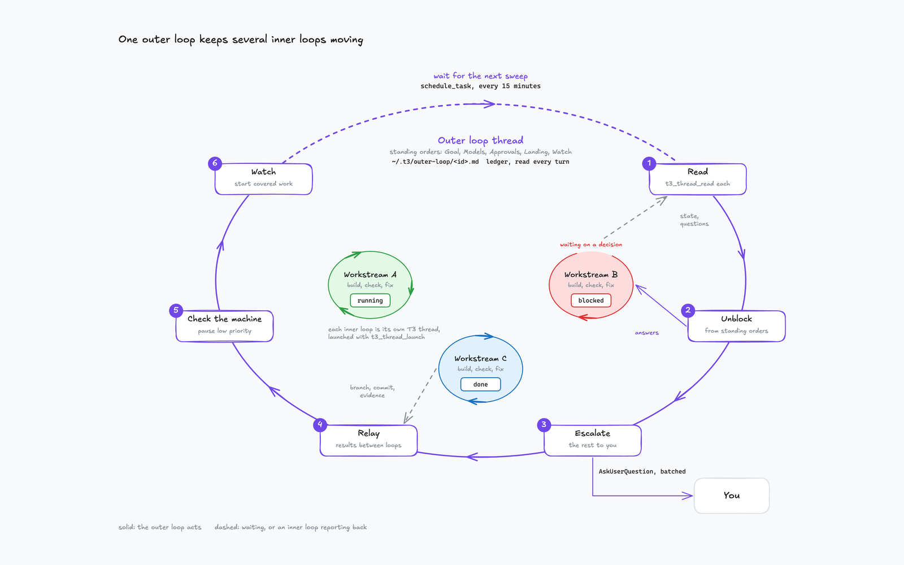
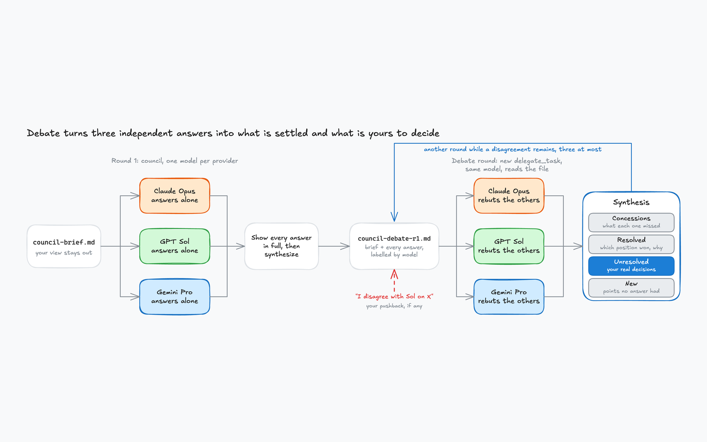
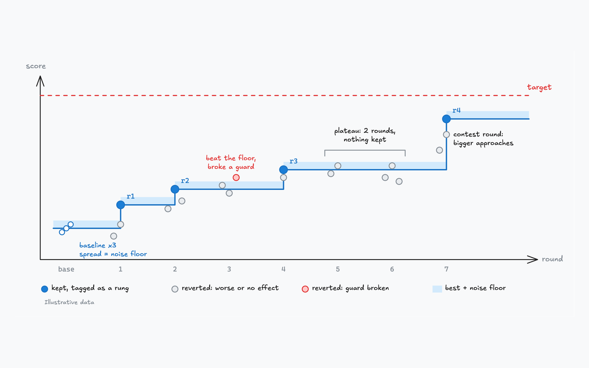
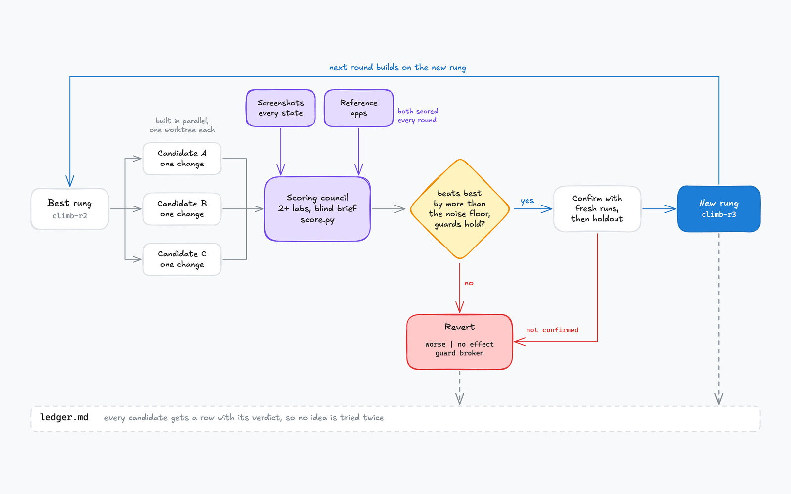

# Agent Skills

A personal collection of reusable agent skills, installable with [`skills`](https://github.com/vercel-labs/skills).

The skills are built and tested in [T3 Code](https://github.com/pingdotgg/t3code). Its
`delegate_task` runs subagents on models from different providers, and its thread tools let one
conversation manage others. Some skills need those tools; the rest work in any agent and run
best in T3 Code.

## Skills

### For work

<table>
<tr>
<td width="50%" valign="top">
<a href="./skills/outer-loop-t3/"></a>
<br><a href="./skills/outer-loop-t3/"><strong><code>outer-loop-t3</code></strong></a><br>
One thread that launches, unblocks and supervises your other threads<br>Say <em>"outer loop"</em>
</td>
<td width="50%" valign="top">
<a href="./skills/council-debate/"></a>
<br><a href="./skills/council-debate/"><strong><code>council-debate</code></strong></a><br>
Debate rounds for <a href="https://github.com/t3dotgg/tstack/tree/main/skills/council"><code>council</code></a>: models from three labs answer, then rebut each other<br>Say <em>"council, debate this"</em>
</td>
</tr>
<tr>
<td width="50%" valign="top">
<a href="./skills/hill-climb/"></a>
<br><a href="./skills/hill-climb/"><strong><code>hill-climb</code></strong></a><br>
Push a measured number toward a target, keeping only real wins<br>Say <em>"hill climb this to X"</em>
</td>
<td width="50%" valign="top">
<a href="./skills/ui-climb/"></a>
<br><a href="./skills/ui-climb/"><strong><code>ui-climb</code></strong></a><br>
Climb a screen's design, scored by a blind council of models<br>Say <em>"UI climb"</em>
</td>
</tr>
</table>

### Utilities

| Skill | What it does | Say |
|-------|--------------|-----|
| [ios-app-cleanup](./skills/ios-app-cleanup/) | Bulk-uninstalls apps from a paired iPhone with `xcrun devicectl`, picking them from a generated checklist page with App Store icons | `/ios-app-cleanup` (manual only) |

<details>
<summary><strong>What each skill needs</strong></summary>

| Skill | T3 Code | Model providers | Other skills | System |
|-------|---------|-----------------|--------------|--------|
| outer-loop-t3 | 🔒 Required | One | - | Any |
| council-debate | 🔒 Required | 🌐 Three | [`council`](https://github.com/t3dotgg/tstack/tree/main/skills/council) from t3dotgg/tstack | Any |
| hill-climb | ⭐ Recommended | One | - | Any |
| ui-climb | ⭐ Recommended | 🌐 Two or more | `hill-climb` | Playwright for web, simulator tooling for native |
| ios-app-cleanup | Not used | One | - | macOS with Xcode, `python3`, `curl`, and an iPhone paired with Developer Mode on |

- 🔒 **Required**: the skill calls T3 Code's tools (`delegate_task`, `t3_thread_launch`, `t3_thread_read`, `t3_thread_send`, `schedule_task`) and does not run without them.
- ⭐ **Recommended**: the skill uses T3 Code's tools when they are there and falls back to other harnesses. `hill-climb` builds candidates with Claude Code's `Agent`, another harness's subagents, or one at a time. `ui-climb` can score with lab CLIs (`codex exec`, `claude -p`, `gemini -p`) or API scripts.
- 🌐 **Providers**: models from different labs share fewer defaults, so the skill needs access to models from that many providers. `council` reports a missing provider instead of substituting another model.

</details>

## Related work

`hill-climb` and `ui-climb` build on [rebase-energy/hillclimb](https://github.com/rebase-energy/hillclimb)
and borrow from other public hill-climbing skills. They differ in running competing candidates in
parallel rounds with the owner in the loop; the others suit a single agent left to climb alone.

- [Bil0000/Hill-Climb](https://github.com/Bil0000/Hill-Climb): a script that locks the check and keeps or undoes each step, with paired timing, a holdout and multi-provider judges. Source of counting the work, finding the floor, the cheat list, repairs and milestone checks.
- [pstack's hillclimb playbook](https://github.com/cursor/plugins/blob/main/pstack/skills/poteto-mode/playbooks/hillclimb.md): one hypothesis per attempt and a decision log. Source of the stop rule with a minimum number of rounds.
- [autolab-ai/hills](https://github.com/autolab-ai/hills): a frozen evaluator that signs its reports. Source of what the number stands for and the final split scored once.

## Install

```bash
# Pick skills interactively
npx skills add richard-better/agent-skills

# Or install one directly
npx skills add richard-better/agent-skills --skill council-debate
```

Add `-g` to install globally instead of into the current project, and `-a <agent>` to target a specific agent (e.g. `claude-code`, `codex`).

Install a skill's dependencies too: `ui-climb` with `hill-climb`, and `council-debate` with `council`:

```bash
npx skills add richard-better/agent-skills --skill hill-climb
npx skills add richard-better/agent-skills --skill ui-climb
npx skills add t3dotgg/tstack --skill council
```
