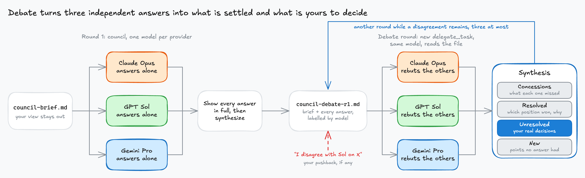

# Council debate

Adds debate rounds to the [`council`](https://github.com/t3dotgg/tstack/tree/main/skills/council)
skill. After models from three labs answer independently, each one reads the others' answers and
rebuts them, so you end up with what is settled and what is really yours to decide.

## How it works

1. **Round 1.** The brief goes to a file, stated neutrally, so your own view never reaches the
   members. `council` runs one model per provider, and every answer is shown in full before the
   synthesis.
2. **Debate round.** A file carries the brief, every answer labelled by model and your pushback.
   Each member gets a new `delegate_task` on the same model and answers a fixed rebuttal prompt:
   where the others are right, where they are wrong, and what nobody has said.
3. **Synthesis** splits the result into concessions, resolved debates, unresolved
   disagreements (your real decisions) and new points no first answer had.

One debate round by default, more while a disagreement remains, three at most.

## Use it

Install `council` from t3dotgg/tstack too, then say "council, debate this". It needs T3 Code and
models from three providers; see [what each skill needs](../../README.md#skills).
