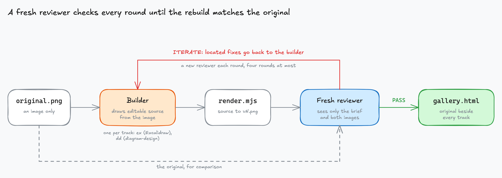

# Diagram rebuild

Rebuilds a diagram that exists only as an image (a screenshot, a PNG, an export from a tool you no
longer have) into source you can edit: an Excalidraw scene, a
[`diagram-design`](https://github.com/cathrynlavery/diagram-design) page, or both. Every label,
arrow and annotation is kept word for word; the target style decides the look.

## How it works

1. **Setup** installs a pinned render toolchain once into `~/.cache/diagram-rebuild`: Playwright
   with Chromium, and Excalidraw's own exporter so renders use its real fonts.
2. **Build.** One builder per image and track reads the original and writes a generator for the
   source, renders it to `vN.png`, and checks the render before reporting.
3. **Review.** A fresh reviewer that has never seen the builder's notes compares the render with
   the original, scores content and quality, and returns `PASS` or `ITERATE` with located fixes.
   Each round gets a new reviewer, four rounds at most.
4. **Deliver.** A gallery page shows each original beside the latest render of every track.

Builders and reviewers run as subagents in T3 Code, Claude Code or any harness that has them.
Without subagents the skill builds by itself and gets each review from a one-shot agent CLI
(`claude -p`, `codex exec`, `gemini -p`).

## Use it

Install `diagram-design` from cathrynlavery/diagram-design too for the `dd` track, then say
"rebuild this diagram" with the image. It needs `node`, `npm` and `python3`; see
[what each skill needs](../../README.md#skills).
