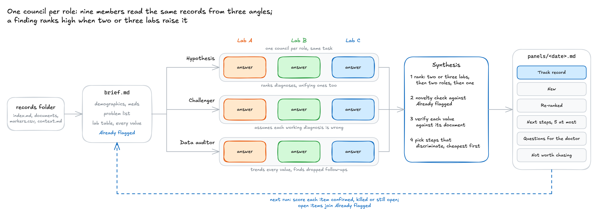

# Health differential

A second look at your health records by a panel of models, modelled on Microsoft's MAI-DxO.
It looks for what the records have not already flagged: patterns across specialties,
drift inside reference ranges, follow-ups that dropped, diagnoses that stalled.



## How it works

1. The agent reads a records folder built by [`health-records`](../health-records/) and writes a
   case brief, including everything the records **already** flag.
2. It runs one [`council`](../council/) per role, so models from three labs each take every
   role in fresh context, nine answers in all: a hypothesis generator, a challenger who assumes
   every working diagnosis is wrong, and a data auditor who trends every value.
3. The agent merges their findings, ranks what two or three labs raised independently above
   what one member raised, drops anything already flagged, and checks every cited value against
   its source.
4. The report goes to `panels/<date>-health-differential.md`: new findings, re-ranked
   hypotheses, at most five next steps by information per cost, and questions to bring to a
   doctor.
5. The next run first scores the last report's items as confirmed, killed or still open, so the
   panel builds a track record.

It prepares you for a clinician; it does not diagnose. The council reads your records, so their
content goes to all three model providers.

## Install

```bash
npx skills add richard-better/agent-skills --skill health-records
npx skills add richard-better/agent-skills --skill council
npx skills add richard-better/agent-skills --skill health-differential
```

Needs models from three providers. Runs best in T3 Code, whose `delegate_task` puts each member
on its model; elsewhere `council` uses subagents or the labs' CLIs.
