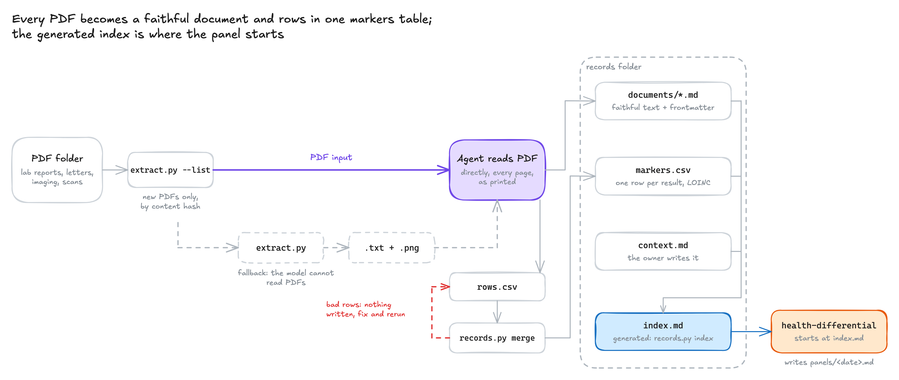

# Health records

Turn a pile of health PDFs into a records folder an agent can reason over. Lab reports,
discharge letters and imaging reports, typed or scanned, in any language, become one faithful
Markdown file each. Every lab result lands in a single `markers.csv` with a canonical name and
LOINC code, so ferritin from three labs in two languages reads as one trend.



## How it works

1. `extract.py --list` finds the PDFs not yet in the folder, by content hash. The agent reads
   each one directly as a PDF, so it sees the layout, stamps and scanned pages as printed. An
   agent that cannot read PDFs falls back to `extract.py`, which pulls each page's text layer
   and renders the pages that need eyes as images.
2. The agent writes `documents/<date>_<type>_<provider>.md`: the original wording, every value,
   and frontmatter with date, type, provider and a one-line summary.
3. It stages each result as a row, and `records.py merge` names it from a table of common
   analytes (English, Hungarian and German names) and the folder's own aliases, computes flags
   from reference ranges, and merges it. Rerunning on the same document replaces its rows.
4. `records.py index` regenerates `index.md`: every document, and the latest value of every
   analyte with its history. The [`health-differential`](../health-differential/) skill starts there.

Reruns over the same PDF folder only pick up new files.

## Install

```bash
npx skills add richard-better/agent-skills --skill health-records
```

Needs [`uv`](https://docs.astral.sh/uv/), which installs PyMuPDF and PyYAML for the scripts,
and a model that reads PDFs (or, as a fallback, images). Your records stay in the folder you choose.
