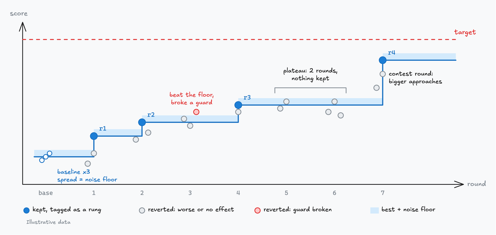
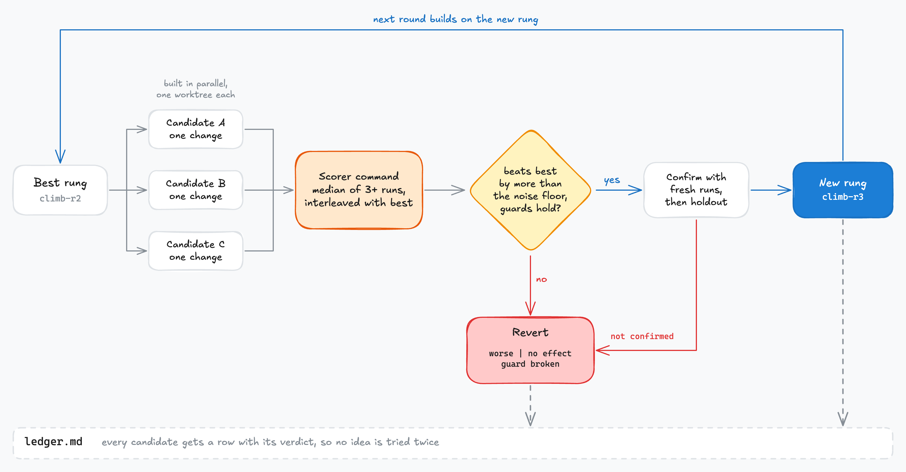

# Hill climb

Pushes one measured number (bundle size, response time, eval pass rate) toward a target. Each
round builds competing candidates in parallel and keeps one only when it beats the best by more
than the noise floor.

## How it works

A climb needs two things before the first change: a command that prints the number, and a
concrete target. The best score then moves in rungs. Changes inside the noise floor are reverted,
plateaus trigger a contest round with bigger approaches, and a holdout catches overfitting.

Every candidate gets a row in the ledger with its verdict, kept or reverted, so no idea is tried
twice.

## Use it

Say "hill climb this to X". It runs in any agent and best in T3 Code, which builds candidates in
parallel; see [what each skill needs](../../README.md#skills).
