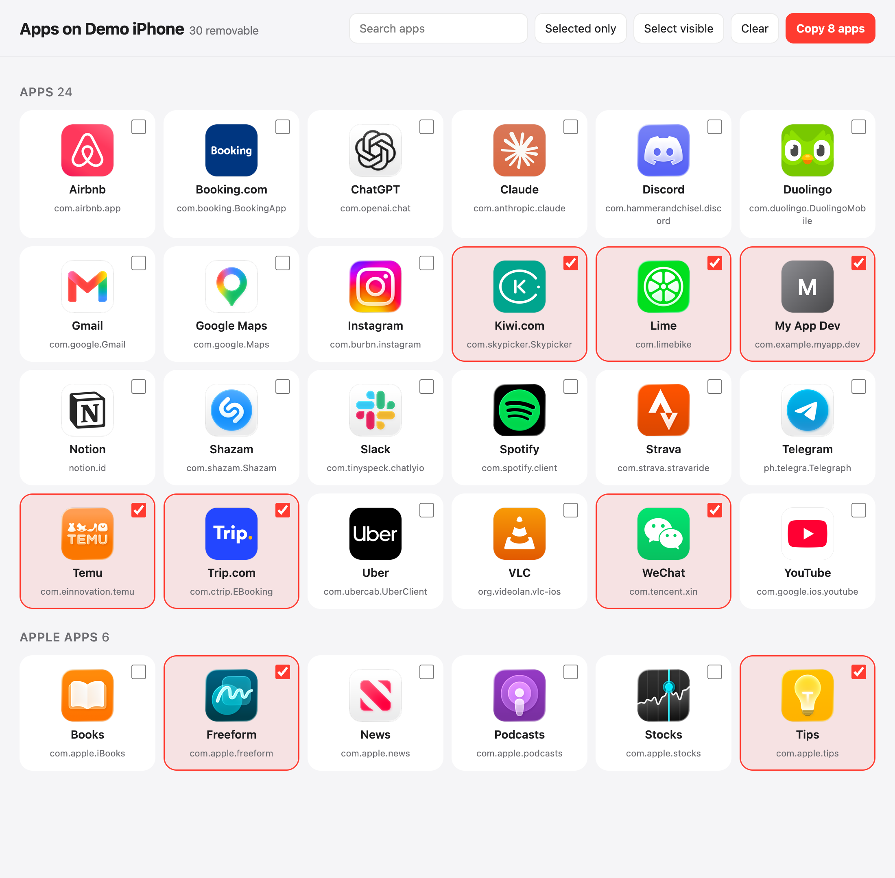

# iOS App Cleanup

Bulk-delete apps from your iPhone with an agent. It lists every app on a phone paired with
your Mac, builds a checklist page with App Store icons, and uninstalls whatever you tick.



## How it works

1. Pair the iPhone with your Mac and turn on Developer Mode
   (Settings > Privacy & Security > Developer Mode).
2. Run `/ios-app-cleanup`. The agent finds the phone with `xcrun devicectl`, lists its apps,
   and opens the checklist page in your browser.
3. Tick the apps to remove (search, "Selected only" and "Select visible" help with long lists),
   press **Copy N apps**, and paste the list back to the agent.
4. The agent uninstalls them and re-lists the phone's apps to confirm they are gone.

Works for App Store apps, developer builds, and removable Apple apps. Uninstalling deletes the
app's data on the phone.

## Install

```bash
npx skills add richard-better/agent-skills --skill ios-app-cleanup
```

Manual invoke only: the agent will not start it on its own.
