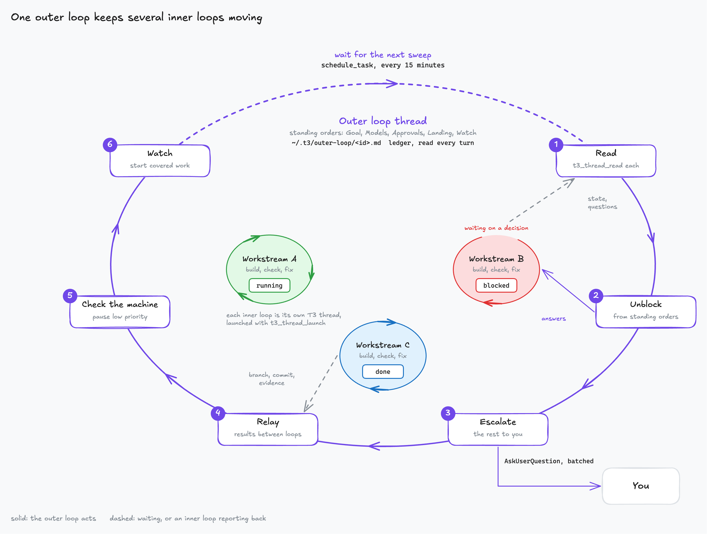

# Outer loop (T3 Code)

Turns one T3 Code thread into the only conversation you need. It launches, unblocks and
supervises your other threads, the workstreams, and brings you just the decisions that are yours.

## How it works

Each workstream is its own T3 thread in its own worktree, running its own build, check and fix
loop. The outer loop circles around them:

1. **Standing orders.** Your request becomes a goal per workstream, plus what the loop may
   approve for you, how finished work lands, and which signals may start work.
2. **Launch or adopt.** New threads start with `t3_thread_launch`; existing ones are adopted.
   Every workstream gets a reporting line back to the outer loop.
3. **Sweep** every 15 minutes with `schedule_task`: read each thread, answer what the standing
   orders cover, batch the rest into one question for you, relay results between workstreams,
   and pause low-priority work when the machine is overloaded.
4. **Done** means the workstream reported evidence: a passing reproduction, checks it ran, a
   screenshot.

The ledger at `~/.t3/outer-loop/<thread id>.md` keeps the orders and a dated history of every
workstream, so the loop survives compaction.

## Use it

Say "outer loop" in a T3 Code thread and describe the work. It needs T3 Code's thread tools; see
[what each skill needs](../../README.md#skills).
