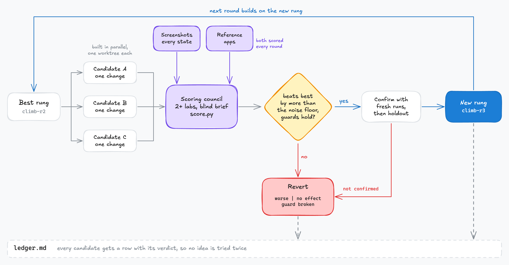

# UI climb

A [hill climb](../hill-climb/) on how a screen looks. No program can score that, so a blind
council of models from different labs scores screenshots against reference apps, and you check
before-and-after pages along the way.

## How it works

The round is the same as in `hill-climb`; only the scorer changes. Screenshots of the product
and the references go to the scoring council, which rates them blind against a rubric. Whatever
a program can measure (contrast, clipped text, tap counts) stays a measured guard. Fixtures use
the real screens with realistic data, so weak sample content does not read as weak design.

## Use it

Install `hill-climb` too, then say "UI climb". It needs models from two or more providers, and
Playwright for web or simulator tooling for native apps; see
[what each skill needs](../../README.md#skills).
